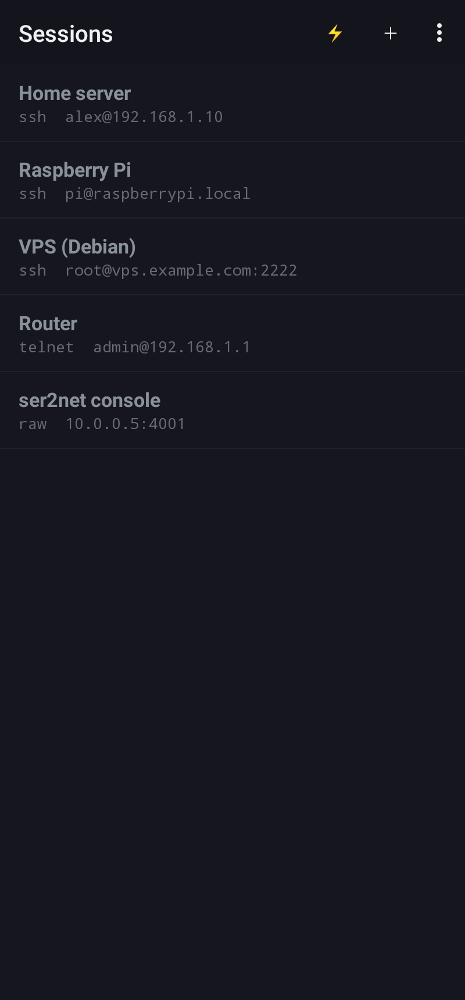
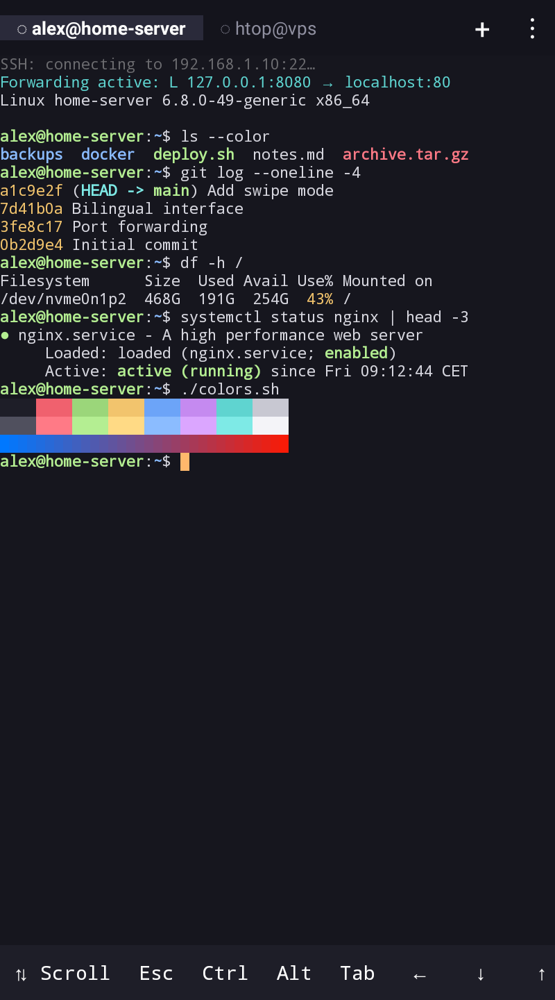
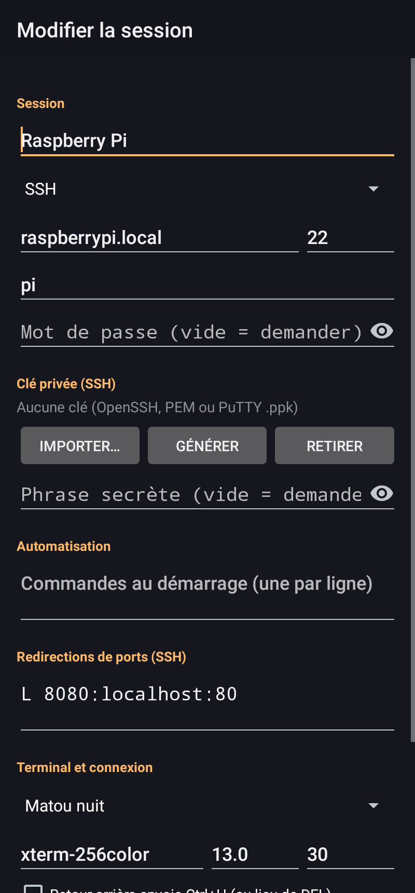

# Matou

> [English documentation](README.md)

Client SSH / Telnet pour Android dans l'esprit de [KiTTY](https://github.com/cyd01/KiTTY) (le PuTTY amélioré) :
des sessions sauvegardées, de l'auto-login, des commandes au démarrage et un vrai émulateur xterm.

> Prototype (v0.1). **Inspiré de [KiTTY](https://github.com/cyd01/KiTTY)** (le fork de PuTTY), Matou est un
> projet indépendant écrit de zéro en Kotlin : il ne partage aucun code avec KiTTY ni PuTTY et n'est
> ni affilié ni soutenu par leurs auteurs.

## Captures d'écran

<p align="center">
  
  
  
</p>

## Fonctionnalités

**Sessions**
- Liste de sessions sauvegardées (nom, protocole, hôte, port, utilisateur), triées par dernière utilisation
- Connexion rapide : `utilisateur@hôte:port`, `ssh://…`, `telnet://…`, `raw://…`
- Dupliquer / modifier / supprimer une session, dupliquer une session ouverte dans un nouvel onglet
- Mots de passe et phrases de passe chiffrés avec le Keystore Android (AES-GCM)
- Bouton **Quitter** dans la liste des sessions et dans la notification : ferme toutes les connexions

**Protocoles**
- SSH (via [JSch, fork mwiede](https://github.com/mwiede/jsch)) : mot de passe, keyboard-interactive, clé privée
  OpenSSH / PEM / **PuTTY `.ppk`**, génération d'une clé ed25519 dans l'app, vérification des clés d'hôte
  (`known_hosts`), keepalive, option « anciens algorithmes » (ssh-rsa SHA-1, CBC) pour les vieux équipements
- Redirection de ports locale (`L 8080:localhost:80`) et distante (`R 2222:localhost:22`)
- Telnet avec négociation (écho, type de terminal, taille de fenêtre NAWS) et **auto-login** sur les invites
  `login:` / `password:` (personnalisables)
- TCP brut
- Commandes envoyées automatiquement après la connexion (l'« autocommand » de KiTTY)
- Reconnexion : Entrée après une déconnexion, ou menu « Reconnecter »
- **Transfert de fichiers SFTP** sur la connexion SSH ouverte (télécharger, envoyer, renommer, supprimer),
  avec repli **SCP** pour les routeurs et petits appareils sans SFTP
- **Journal de session** dans un fichier : texte lisible ou sortie brute, à la demande ou à chaque connexion

**Terminal**
- Émulation xterm : 256 couleurs et truecolor, gras/italique/souligné/inverse, écran alternatif (vim, htop, less),
  régions de défilement, caractères larges (CJK, emoji), jeu graphique DEC (cadres), titres OSC, presse-papiers OSC 52,
  collage « bracketed paste », souris (X10/SGR) pour mc, htop, tmux…
- Historique de 5000 lignes, défilement au doigt, zoom à deux doigts
- Sélection par appui long puis glisser, copier / coller, « tout copier »
- Barre de touches : Échap, Ctrl et Alt (appui = une fois, appui long = verrouillé), Tab, flèches, Début/Fin,
  PgPréc/PgSuiv, F1-F12, symboles
- Onglets (appui long pour fermer), 8 thèmes (dont « PuTTY classique »), taille de police par session
- Service de premier plan qui garde les connexions ouvertes en arrière-plan
- Interface en **français et en anglais**, selon la langue du téléphone

## Compiler

Prérequis : JDK 17+, SDK Android (plateforme 35).

```sh
./gradlew assembleDebug          # APK dans app/build/outputs/apk/debug/
MATOU_CORE_ONLY=1 ./gradlew :core:test   # tests du cœur, sans SDK Android
```

La CI GitHub Actions compile l'APK à chaque push et le publie comme artefact (`matou-debug-apk`).

## Structure

- `core/` : Kotlin pur, testé sur la JVM. Émulateur (`Terminal`), tampon d'écran (`Screen`), encodage clavier
  (`KeyEncoder`), Telnet (`TelnetCodec`), auto-login (`AutoResponder`)
- `app/` : l'application Android. Transports SSH/Telnet/TCP (`Transport.kt`), sessions (`TerminalSession.kt`),
  vue terminal dessinée sur Canvas (`TerminalView.kt`), écrans de sessions et d'édition

## Pistes

Port série USB, agent SSH, proxy (SOCKS/HTTP/saut
SSH), redirection dynamique (SOCKS), import des sessions depuis le registre PuTTY/KiTTY.

## Licence

[MIT](LICENSE).
