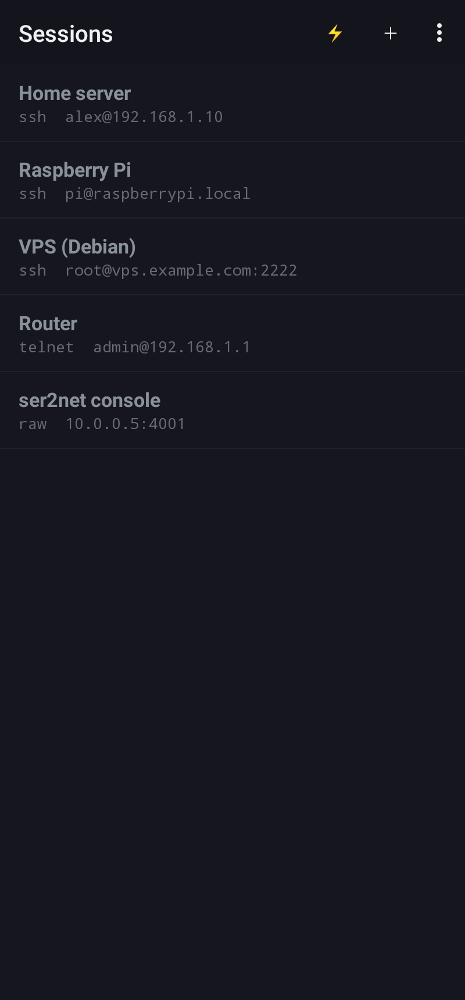
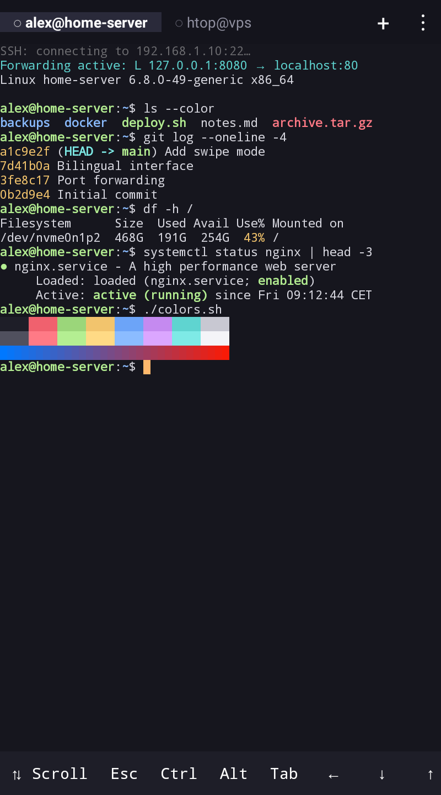
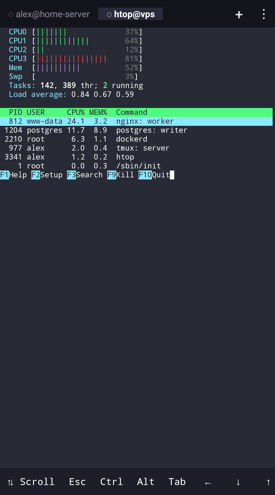
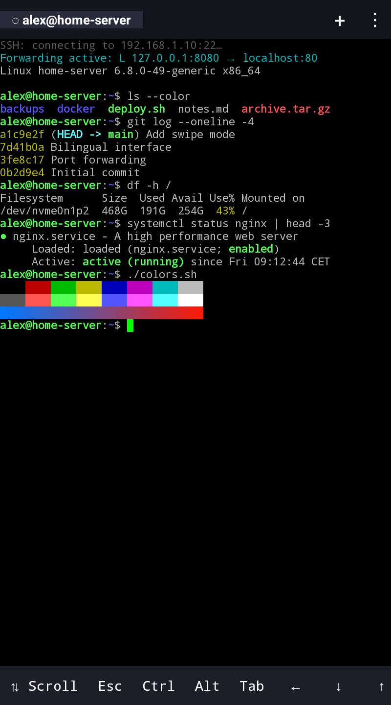
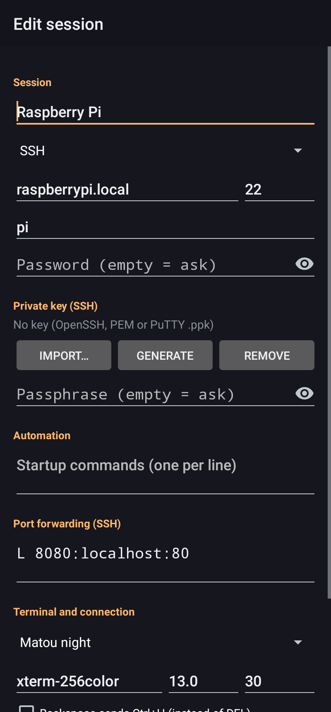
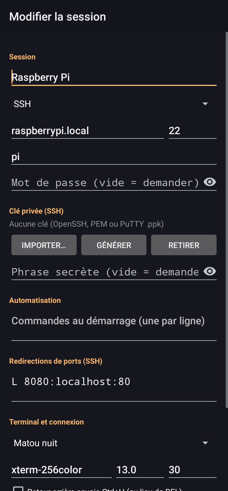

  

<h1 align="center">Matou</h1>

  <b>An SSH, Telnet and raw TCP client for Android, inspired by <a href="https://github.com/cyd01/KiTTY">KiTTY</a>.</b> 
  Saved sessions · key authentication (OpenSSH &amp; PuTTY <code>.ppk</code>) · port forwarding · auto-login · a real xterm emulator

  
  
  
  

<a href="README.fr.md">Version française</a>

---

Matou is **inspired by [KiTTY](https://github.com/cyd01/KiTTY)**, the popular Windows fork of
[PuTTY](https://www.chiark.greenend.org.uk/~sgtatham/putty/) that adds session management,
auto-login and automatic commands. If you've ever used PuTTY or KiTTY to manage a fleet of servers,
routers and embedded boards, Matou brings that workflow to your phone: a list of saved sessions you tap to
connect, credentials and keys stored safely, commands sent automatically on login, and a terminal
that renders `vim`, `htop`, `tmux` and `mc` correctly.

> **Status:** early prototype (v0.2.0).
>
> **Independent project.** Matou takes its ideas from KiTTY, but it is a separate application
> written from scratch in Kotlin. It shares no code with KiTTY or PuTTY and is not affiliated with,
> endorsed by or supported by their authors. Please report Matou issues here, not to them.

## Screenshots

  
  
  

  
  
  

## Features

### Sessions
- **Saved sessions** with name, protocol, host, port, user, credentials, theme and font size, sorted by last use
- **Quick connect**: type `user@host:port`, `ssh://…`, `telnet://…` or `raw://…`
- Edit, **duplicate** and delete sessions; duplicate an open session into a new tab
- Passwords and key passphrases **encrypted with the Android Keystore** (AES-256-GCM)
- **Quit** from the session list or the notification: closes every connection at once

### Protocols
| | SSH | Telnet | Raw TCP |
|---|:---:|:---:|:---:|
| Password / keyboard-interactive | ✅ | auto-login | — |
| Private keys (OpenSSH, PEM, PuTTY `.ppk` v2/v3) | ✅ | — | — |
| In-app ed25519 key generation | ✅ | — | — |
| Host key verification (`known_hosts`) | ✅ | — | — |
| Local & remote port forwarding | ✅ | — | — |
| File transfer (SFTP, SCP fallback) | ✅ | — | — |
| Session logging (text or raw) | ✅ | ✅ | ✅ |
| Startup commands | ✅ | ✅ | ✅ |
| Window size (pty / NAWS) | ✅ | ✅ | — |
| Keep-alive | ✅ | TCP | TCP |

- **Legacy algorithms** switch (ssh-rsa/SHA-1, CBC ciphers, DH group1/14-sha1) for old switches, NAS and routers
- Modern crypto by default: ed25519, ECDSA and rsa-sha2 keys, `curve25519` and post-quantum hybrid `mlkem768x25519` key exchange, AES-GCM and AES-CTR ciphers
- **Reconnect** by pressing <kbd>Enter</kbd> after a disconnection

### Terminal
- xterm-compatible emulator: 16 / 256 / **truecolor**, bold, italic, underline, inverse, strikethrough
- Alternate screen, scroll regions, insert/delete, tab stops, DEC line drawing, wide characters (CJK, emoji)
- Window title (OSC 0/2), palette queries (OSC 4/10/11), **clipboard** (OSC 52), bracketed paste
- **Mouse reporting** (X10 and SGR), so taps and scrolls work in `htop`, `mc`, `tmux`, `vim`
- 5,000-line scrollback, **pinch to zoom**, and a swipe mode switch: scroll the output or browse the command history
- **Selection** with long-press and drag, copy / paste / copy all
- **Extra keys bar**: Esc, Ctrl, Alt (sticky or locked), Tab, arrows, Home/End, PgUp/PgDn, F1–F12, symbols
- **Tabs**, 8 built-in **themes** (including *PuTTY classic*, Solarized, Dracula, Gruvbox, Nord)
- A foreground service keeps connections alive while the app is in the background
- Interface in **English and French**, following the phone's language

## Install

1. Download the latest **`matou-release-apk`** from the [Releases](https://github.com/ajefr/Matou_Android/releases)
   page, or from the artifacts of the latest successful [build](https://github.com/ajefr/Matou_Android/actions/workflows/build.yml).
2. On your phone, allow installing apps from your browser or file manager
   (*Settings → Apps → Special access → Install unknown apps*).
3. Open the APK and install it.

Requires **Android 8.0 (API 26)** or later.

> If you previously installed a debug build, uninstall it first: Android refuses to update an app
> signed with a different key.

## Quick start

1. Tap **＋** to create a session, or **⚡** for a one-off connection.
2. Choose the protocol, enter the host, port and user name. Leave the password empty to be asked
   at each connection.
3. Tap the session to connect. On first connection, check and accept the server's host key.
4. Tap the terminal to show the keyboard. Use the bar above the keyboard for Ctrl, Esc, arrows…

See the **[User guide](docs/USER_GUIDE.md)** for keys, port forwarding, Telnet auto-login and more.

## Documentation

- [User guide](docs/USER_GUIDE.md): sessions, authentication, keys, forwarding, Telnet, terminal, gestures, themes, troubleshooting
- [Building from source](docs/BUILDING.md): toolchain, tests, release signing, CI
- [Architecture](docs/ARCHITECTURE.md): how the code is organized
- [Contributing](CONTRIBUTING.md)
- [Changelog](CHANGELOG.md)

## Roadmap

- USB serial (FTDI, CP210x, CH340) for console cables
- Jump hosts and SOCKS/HTTP proxies, dynamic (SOCKS) forwarding
- SSH agent and agent forwarding
- Import sessions from a PuTTY / KiTTY registry export
- Export / import of the session list

## Acknowledgements

- [JSch (mwiede fork)](https://github.com/mwiede/jsch), the SSH implementation (BSD-style license)
- [Bouncy Castle](https://www.bouncycastle.org/), cryptography for Ed25519, X25519, ML-KEM and Argon2 (MIT-style license)
- [KiTTY](https://github.com/cyd01/KiTTY) by cyd01 and [PuTTY](https://www.chiark.greenend.org.uk/~sgtatham/putty/) by Simon Tatham, the inspiration for Matou's features and workflow

## License

Matou is released under the [MIT License](LICENSE).
